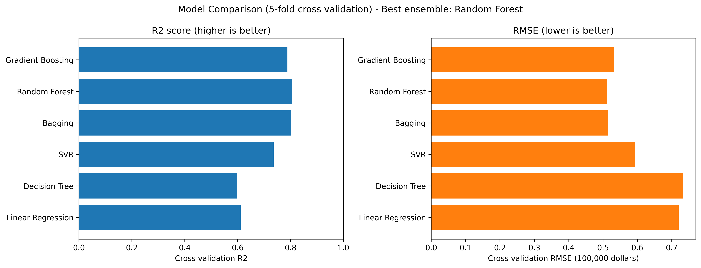
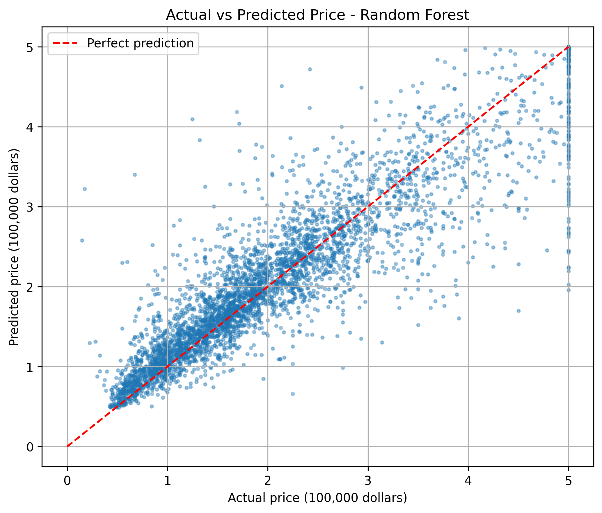
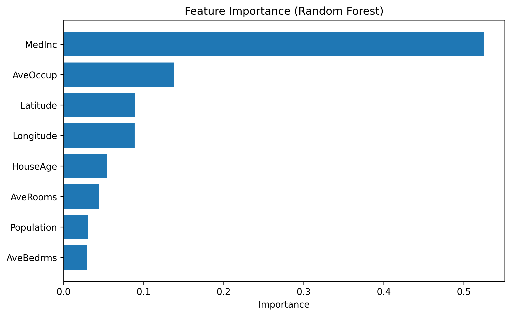
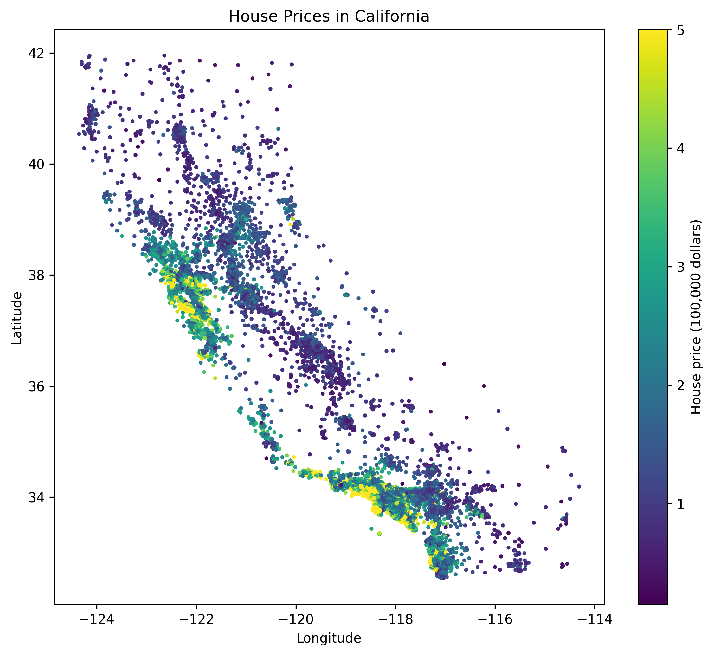

# 🏠 California Housing Price Prediction using Machine Learning Regression: Linear Regression, Decision Tree, SVR, Bagging, Random Forest and Gradient Boosting

A machine learning regression project that predicts the **median house price of a California neighborhood** from its income, house age, rooms, population and location. Six regression models are compared with 5-fold cross validation: three single models (the baseline) and three ensemble models (Bagging, Random Forest and Gradient Boosting). The best ensemble is saved, tested and explained.

## 🎯 Problem Statement
Given 8 facts about a neighborhood, predict its median house value. The answer is a number (a price), so this is a **regression** problem.

## 🛠️ Tech Stack
- Python 3
- pandas
- numpy
- scikit-learn
- matplotlib
- joblib

## 📊 Dataset
- File: `data/california_housing.csv`
- Size: 20,640 neighborhoods, 8 features and 1 target
- Missing values: none. Duplicate rows: none.
- Target: `target`, the median house value in units of 100,000 dollars (4.5 means 450,000 dollars)

| Column     | Description                          |
|------------|--------------------------------------|
| MedInc     | Median income of the area            |
| HouseAge   | Median age of the houses             |
| AveRooms   | Average number of rooms              |
| AveBedrms  | Average number of bedrooms           |
| Population | People living in the area            |
| AveOccup   | Average people per house             |
| Latitude   | Latitude of the area                 |
| Longitude  | Longitude of the area                |
| target     | Median house value (to predict)      |

**Important about the data**
- The prices are **cut off at 500,000 dollars**. 992 areas (4.8 %) have the maximum price, so their real price may be higher. The model cannot predict above this value.
- Income has the strongest link with the price (correlation 0.69). The others are weak: AveRooms 0.15, HouseAge 0.11 and Latitude -0.14.

## 🌳 Models
| Type     | Model              | Idea |
|----------|--------------------|------|
| Single   | Linear Regression  | Fits a straight-line relationship (baseline) |
| Single   | Decision Tree      | One tree of if-else rules (baseline) |
| Single   | SVR                | Support Vector Regression with an rbf kernel (baseline) |
| Bagging  | Bagging Regressor  | 50 trees trained on random samples, results averaged |
| Bagging  | Random Forest      | 100 trees with random features, results averaged |
| Boosting | Gradient Boosting  | Trees trained one after another, each fixing the mistakes of the previous one |

- Linear Regression and SVR use feature scaling (StandardScaler).
- The best **ensemble** is chosen by cross validation R². The single models are the baseline for comparison.

## 🔍 Workflow
1. Load the dataset
2. Check the data quality
3. Display the statistical summary
4. Check the correlation with the price
5. Separate independent and dependent variables
6. Split into training (80 %) and testing (20 %) sets
7. Build the 6 models
8. Compare the models with 5-fold cross validation
9. Select the best ensemble model
10. Train the best ensemble model
11. Save and load the model
12. Evaluate the best model on the test data
13. Show the test scores of all 6 models
14. Plot the graphs
15. Predict the price of some areas
16. Show the project summary

## 📂 Project Structure
```
08-California-Housing-Price-Prediction-Using-Machine-Learning-Regression/
├── data/
│   ├── california_housing.csv
│   └── README.md
├── images/
│   ├── model_comparison.png
│   ├── actual_vs_predicted.png
│   ├── feature_importance.png
│   ├── price_map.png
│   ├── output_1.png
│   ├── output_2.png
│   ├── output_3.png
│   └── README.md
├── models/
│   └── README.md
├── src/
│   ├── main.py
│   └── README.md
├── requirements.txt
└── README.md
```

## ▶️ How to Run
Run from this folder (the one with `requirements.txt`):

```bash
pip install -r requirements.txt
python src/main.py
```

- The program takes about 2.5 minutes, because it trains 6 models with cross validation.
- The charts are saved in the `images` folder, and the model is saved in the `models` folder.

## 🖥️ Sample Output
```
Step 9: Select the best ensemble model
Best ensemble model            : Random Forest
Cross validation R2            : 0.8045

Best single model (baseline)   : SVR
Cross validation R2            : 0.7365

Step 12: Evaluate the best model on the test data
R2 score on test data              : 0.8051
RMSE on test data                  : 0.5053  (about 50,534 dollars)
MAE on test data                   : 0.3275  (about 32,754 dollars)
Baseline MAE (always the average)  : 0.9027  (about 90,272 dollars)
```

## 📸 Output Screenshots


## ✅ Results

| Model             | Type     | CV R² | Test R² | Test RMSE | Test MAE |
|-------------------|----------|-------|---------|-----------|----------|
| Random Forest     | Bagging  | 0.8045 | 0.8051 | 0.5053    | 0.3275   |
| Bagging           | Bagging  | 0.8021 | 0.8036 | 0.5072    | 0.3300   |
| Gradient Boosting | Boosting | 0.7881 | 0.7756 | 0.5422    | 0.3716   |
| SVR               | Single   | 0.7365 | 0.7276 | 0.5975    | 0.3986   |
| Linear Regression | Single   | 0.6115 | 0.5758 | 0.7456    | 0.5332   |
| Decision Tree     | Single   | 0.5973 | 0.6221 | 0.7037    | 0.4547   |

RMSE and MAE are in units of 100,000 dollars.

- **Best ensemble: Random Forest.** It explains about 80 % of the variation in house prices on the test data (R² 0.8051).
- On average, its prediction is about **32,754 dollars** away from the real price (MAE). If we always guessed the average price, the error would be about 90,272 dollars.
- The ensembles beat all the single models. The best single model is SVR (R² 0.7365 in cross validation).
- Random Forest and Bagging are very close (0.8045 and 0.8021), so the difference between them is small.
- A single Decision Tree is weak (R² 0.5973). Averaging many trees (Bagging and Random Forest) raises it to about 0.80.

### Feature importance (Random Forest)

| Feature    | Importance |
|------------|------------|
| MedInc     | 0.525      |
| AveOccup   | 0.138      |
| Latitude   | 0.089      |
| Longitude  | 0.089      |
| HouseAge   | 0.055      |
| AveRooms   | 0.044      |
| Population | 0.031      |
| AveBedrms  | 0.030      |

The neighborhood income is by far the most important measurement. The location (latitude and longitude) together is the next group.

### Model Comparison


### Actual vs Predicted Price


### Feature Importance


### House Price Map


**Notes**
- The test set has 4,128 areas. The results come from one random split, so the scores can change slightly with another split.
- Many points are on the line at the right side of the actual vs predicted chart. They are the areas with the price cut off at 500,000 dollars.
- This project is for learning the machine learning workflow.

## 📚 Learning Outcomes
- Regression with single models and ensemble models (bagging and boosting)
- Why averaging many trees works better than one tree
- Feature scaling for distance-based models such as SVR
- Comparing models with 5-fold cross validation and choosing the best one without using the test data
- Evaluating regression with R², RMSE and MAE, and reading the error in dollars
- Saving and loading a model with joblib
- Feature importance and a price map for explaining the model

## 🚀 Future Improvements
- Tune the Random Forest and Gradient Boosting with GridSearchCV
- Add Ridge, Lasso and AdaBoost regression
- Add new features, for example rooms per person or distance to the coast
- Handle the capped prices (500,000 dollars) in a special way

## 👩‍💻 Author
**Ishwari Vijaykumar Surve**
B.E. Electronics and Computer Engineering | Aspiring Data Science / AI-ML Engineer

GitHub: https://github.com/ishwari-surve
